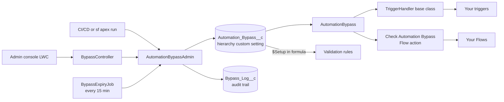

# Salesforce Deployment & Automation Bypass Framework

**Turn off triggers, Flows and validation rules safely during data migrations and deployments, with automatic expiry and a full audit trail.**

  

---

## The problem

Large Salesforce migrations and releases rarely fail because of the data itself. They fail because **org automation fires on every record being loaded**:

| What happens during a bulk load | Typical error |
|---|---|
| Validation rules written for users reject historical data | `FIELD_CUSTOM_VALIDATION_EXCEPTION` |
| Triggers and Flows run per batch and run out of limits | `Apex CPU time limit exceeded`, `Too many SOQL queries: 101` |
| Record-triggered Flows send emails, create tasks or call out | Thousands of customer emails sent by mistake |
| Automation updates parent records in parallel batches | `UNABLE_TO_LOCK_ROW` |
| Duplicate rules and roll-ups re-run on legacy records | Slow loads and partial failures |

The usual fixes are risky. Teams deactivate triggers with an emergency deployment, edit validation rules by hand in production, or add one-off `if (UserInfo.getUserName() == 'migration@…')` checks. And then someone forgets to switch everything back on.

## What this framework does

One switch, read by **Apex triggers, Flows and validation rules**, that is:

- **Scoped:** bypass everything, or only triggers, Flows, validation rules, specific objects or specific trigger handlers
- **Targeted:** for one user (for example the migration or integration user), one profile, or the whole org
- **Time-boxed:** every bypass expires automatically, from 1 to 72 hours
- **Audited:** every enable, change, disable and expiry is written to the `Bypass Log`, with who, why and when
- **Permission-gated:** only users with the `Manage Automation Bypass` permission can change bypasses
- **Pipeline-ready:** turn it on and off from anonymous Apex in a CLI or CI/CD pipeline, with the bypass always switched off afterwards
- **Transaction-scoped too:** Apex can skip a handler or object for one transaction only, for data fix scripts

## Architecture



| Component | Type | Purpose |
|---|---|---|
| `Automation_Bypass__c` | Hierarchy custom setting | Stores the bypass for a user, profile or org. Readable in formulas with `$Setup` |
| `AutomationBypass` | Apex | Answers "is this automation bypassed right now?" Also holds transaction-scoped bypasses |
| `TriggerHandler` | Apex virtual class | Base class for trigger handlers that skips itself when bypassed |
| `BypassFlowCheck` | Invocable Apex | **Check Automation Bypass** action for Flows |
| `AutomationBypassAdmin` | Apex | Enables, disables, expires and lists bypasses, and writes the audit log |
| `BypassExpiryJob` | Schedulable Apex | Removes expired bypasses every 15 minutes |
| `bypassConsole` | LWC + tab | Admin console to manage bypasses |
| `Bypass_Log__c` | Custom object + tab | Audit trail, reportable |
| `Automation_Bypass_Admin` | Permission set | Grants the console, the permission and log access |

## Install

```bash
git clone https://github.com/pavankoppula92/Salesforce-Deployment-Automation-Bypass-Framework.git
cd Salesforce-Deployment-Automation-Bypass-Framework

sf org login web --alias myorg
sf project deploy start --source-dir force-app --target-org myorg
sf org assign permset --name Automation_Bypass_Admin --target-org myorg
sf apex run --file scripts/apex/schedule-expiry-job.apex --target-org myorg
```

To try the example Account trigger as well:

```bash
sf project deploy start --source-dir examples --target-org myorg
```

Then open the **Automation Bypass** tab from the App Launcher.

## Make your automation bypass-aware

### Apex triggers

Extend `TriggerHandler` and keep one line in the trigger:

```apex
trigger AccountTrigger on Account (before insert, before update, after insert, after update) {
    new AccountTriggerHandler().run();
}

public with sharing class AccountTriggerHandler extends TriggerHandler {
    protected override void beforeInsert() {
        // your logic, using newRecords, oldMap, etc.
    }
}
```

The handler is skipped when triggers, its object (`Account`) or its class name (`AccountTriggerHandler`) is bypassed.

Already have a trigger framework? Add one check at the top of your dispatcher instead:

```apex
if (AutomationBypass.isTriggerBypassed('AccountTriggerHandler', Account.SObjectType)) { return; }
```

### Flows

Add the **Check Automation Bypass** action (category *Automation Bypass*) as the first element. Pass the object API name, and add a **Decision** that ends the Flow when **Is Bypassed** is true.

For a lighter check with no Apex call, use a Decision on the custom setting directly:

```
{!$Setup.Automation_Bypass__c.Bypass_Flows__c} Equals True  →  End
```

### Validation rules

Wrap the existing condition so that it does not fire while the bypass is active and not expired:

```
AND(
  NOT(
    AND(
      OR($Setup.Automation_Bypass__c.Bypass_Validation_Rules__c, $Setup.Automation_Bypass__c.Bypass_All__c),
      OR(ISBLANK($Setup.Automation_Bypass__c.Expires_At__c), $Setup.Automation_Bypass__c.Expires_At__c > NOW())
    )
  ),
  /* your original condition, for example: */
  ISBLANK(Industry)
)
```

### One transaction only (data fix scripts)

```apex
AutomationBypass.bypassHandler('OpportunityTriggerHandler');
update opportunitiesToFix;
AutomationBypass.clearRuntime();
```

## Use it in a migration

**From the console:** pick the migration user, choose what to bypass, set the hours and a reason, and click **Enable bypass**. Disable it when the load finishes, or let it expire.

**From a pipeline:** set the username in `scripts/apex/enable-bypass.apex` and `disable-bypass.apex`, then:

```bash
scripts/load-with-bypass.sh myorg Account data/accounts.csv Legacy_Id__c
```

The script enables the bypass, runs a Bulk API upsert, and **always** disables the bypass afterwards, even when the load fails.

See the full [Migration Runbook](docs/MIGRATION_RUNBOOK.md) for a step-by-step process, checks and rollback.

## Safety by design

| Risk | How the framework handles it |
|---|---|
| Someone forgets to switch automation back on | Every bypass expires, at 72 hours at most, and the expiry job removes it |
| Bypass applied to everyone by mistake | Defaults to one user. Org-wide needs an explicit confirmation |
| No record of who turned validation off | Every change is in `Bypass_Log__c`, which admins can read but not edit |
| Unauthorized users enabling bypasses | Console and controller require the `Manage Automation Bypass` custom permission |
| Data loaded without business rules | Use it only for data validated before the load, and run post-load data quality reports |

## Tests

Apex tests cover every class: the hierarchy lookup, expiry, object and handler matching, runtime bypasses, every trigger event, input validation, the audit log, the expiry job and the controller's permission check.

```bash
sf apex run test --target-org myorg --test-level RunSpecifiedTests \
  --tests AutomationBypassTest --tests TriggerHandlerTest --tests AutomationBypassAdminTest \
  --tests BypassControllerTest --tests BypassExpiryJobTest --tests BypassFlowCheckTest \
  --code-coverage --result-format human --wait 10
```

The GitHub Actions workflow validates the deployment and runs these tests against an org when you add an `SFDX_AUTH_URL` repository secret.

## Roadmap

- [ ] Bypass by permission set group, in addition to user, profile and org
- [ ] Platform event when a bypass is enabled, for Slack or Teams alerts
- [ ] Report and dashboard package for the Bypass Log
- [ ] Duplicate rule and assignment rule guidance for bulk loads

## Author

**Pavan Koppula**, Senior Salesforce Developer. [LinkedIn](https://www.linkedin.com/in/pavan-koppula-a615a4159/) · [Trailblazer](https://www.salesforce.com/trailblazer/pkoppula6)

## License

MIT © Pavan Koppula
